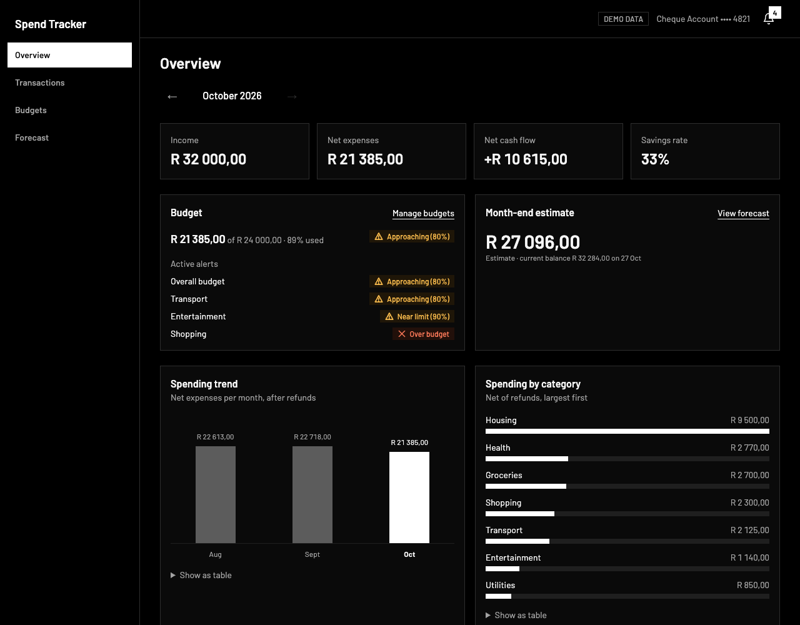
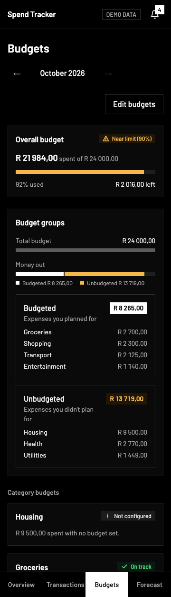

# Spend Tracker

[](https://github.com/CMadiope/spend-tracker/actions/workflows/ci.yml)

**Live demo:** <https://spend-tracker-nine-gray.vercel.app/>

A customer spending insights dashboard built with Next.js 16. It answers three questions:

1. Where did my money go?
2. Am I on track against my budget?
3. What will my balance be at month-end?

All data is **synthetic demo data** for a South African cheque account (ZAR, `en-ZA`, `Africa/Johannesburg`). There are no bank connections, credentials or backend. Alerts are **in-app only**, and the month-end figure is an **estimate** based on scheduled items.





## Features

| Page         | What it does                                                                                                                                                                                                                                                                           |
| ------------ | -------------------------------------------------------------------------------------------------------------------------------------------------------------------------------------------------------------------------------------------------------------------------------------- |
| Overview     | Income, net expenses (compared with last month), net cash flow and savings rate; a Track my spend card (budget ring, money out split into budgeted and unbudgeted spend, active alerts); month-end estimate; spending by category; recent transactions                                 |
| Transactions | Filter by month, category and type; search by description or merchant                                                                                                                                                                                                                  |
| Budgets      | Overall and per-category budgets with usage, remaining or overspend, and status; budget groups showing spend you planned for and didn't; suggested limits from your average spend in earlier months; edit form with inline validation for the current month; past months are read-only |
| Forecast     | Current balance, projected month-end balance, timeline with running balance, negative-balance warning; add, edit and pause scheduled items                                                                                                                                             |
| Alerts       | Bell with unread count; alert panel with mark read, dismiss and a link to the budget                                                                                                                                                                                                   |

## Quick start with Docker

```bash
docker build -t spend-tracker .
docker run --rm -p 3000:3000 spend-tracker
```

Open <http://localhost:3000>. The image runs as a non-root user with `TZ=Africa/Johannesburg`.

## Local development

Requires Node 24 and npm.

```bash
npm ci
npm run dev
```

| Script                                    | Purpose                                                        |
| ----------------------------------------- | -------------------------------------------------------------- |
| `npm run dev`                             | Development server                                             |
| `npm run build` / `npm start`             | Production build and server                                    |
| `npm run lint`                            | ESLint                                                         |
| `npm run typecheck`                       | Generate route types, then `tsc --noEmit`                      |
| `npm test` / `npm run test:watch`         | Vitest unit and component tests                                |
| `npm run e2e`                             | Production build, then Playwright with axe (desktop and 360px) |
| `npm run format` / `npm run format:check` | Prettier                                                       |

Run `npx playwright install chromium` once before the first `npm run e2e`.

CI runs on every pull request: lint, format check, typecheck, unit tests, build, Playwright, then `docker build`.

## Architecture

```text
app/          routes: overview, transactions, budgets, forecast
components/   UI by feature: alerts, budgets, charts, dashboard, forecast, shell, transactions, ui
interfaces/   domain types, inferred from the Zod schemas
lib/          pure logic: dates, money, data, spending, budgets, alerts, forecast, transactions
lib/store/    client store with versioned localStorage (the only non-pure part of lib/)
e2e/          Playwright journeys and accessibility checks
```

Pages are Server Components. Only interactive pieces (the alert bell, budget and forecast views, forms) are client components. Components receive derived values and do no financial arithmetic themselves.

| Decision       | Choice                                                                                                                                              | Why                                                 |
| -------------- | --------------------------------------------------------------------------------------------------------------------------------------------------- | --------------------------------------------------- |
| Today          | The real date in `Africa/Johannesburg` (`lib/dates/clock.ts`); pure functions take `today` as a parameter                                           | The app is always current; tests pass fixed dates   |
| Demo data      | Generated relative to today: the current month and the two before it                                                                                | Every month the app is opened in has data           |
| Dates          | `YYYY-MM-DD` strings; `Date` is only constructed inside `lib/dates`, in UTC                                                                         | No timezone shift between server and browser        |
| Money          | Integer cents everywhere; formatting only in `lib/money/format.ts`                                                                                  | No floating-point drift                             |
| Selected month | `?month=2026-10`, validated with Zod, falling back to the current month                                                                             | Server-rendered, shareable, back button works       |
| User edits     | Budgets, scheduled items and alert state live in `localStorage` (versioned, Zod-validated), read with `useSyncExternalStore`, skeleton until loaded | Edits survive a reload without hydration mismatches |
| Rendering      | Cache Components: static shell, request-time data inside `<Suspense>` after `await connection()`                                                    | Fast first paint; the clock is read per request     |
| Alerts         | Derived from budget status, never stored; only read, dismissed and first-seen state is saved                                                        | No duplicates by construction                       |
| Charts         | Plain HTML and CSS bars, each with a "Show as table" view                                                                                           | No chart library; text never distorts when resized  |
| Styling        | Tailwind CSS v4 with design tokens in `app/globals.css`; colour is reserved for status                                                              | One place to change the palette                     |

## Calculation rules

**Spending**

- Net expenses = expenses − refunds dated in the month. Transfers are excluded from income, expenses and savings rate, but included in the balance.
- Net cash flow = income − net expenses. Savings rate = net cash flow ÷ income, shown as "—" when there is no income.
- A refund reduces its category in the month of the refund date. Category spend floors at zero for budget usage.

**Budget status**, compared in whole cents for a budget `B > 0` and spend `S`:

| Condition          | Status            |
| ------------------ | ----------------- |
| `S × 100 < B × 80` | On track          |
| `S × 100 < B × 90` | Approaching (80%) |
| `S < B`            | Near limit (90%)  |
| `S = B`            | Reached (100%)    |
| `S > B`            | Over budget       |

A category without a budget is "Not configured". A budget of R0 is "No budget set", or "Unbudgeted spending" if money was spent. Category budgets are allocations within the overall budget; the form warns, without blocking, when they add up to more than the total.

**Alerts**

- One alert per budget at its highest current level: 80%, 90%, 100% or over.
- Each alert has the key `month:scope:level`, for example `2026-10:category:groceries:90`. Rising a level creates a new key, so the alert is unread again. A refund that drops the level removes the alert; returning to that level restores its original read or dismissed state instead of issuing it again. A new month starts fresh.
- Screen readers hear one polite announcement when an alert level first appears.

**Forecast**

```text
currentBalance   = openingBalance + Σ transactions (openingDate < date ≤ today)
projectedBalance = currentBalance + Σ scheduled income − Σ debit orders − Σ expected expenses
                   for occurrences with today < date ≤ end of the selected month
```

- Available for the current and next two months; past months link to their actual transactions and hide the scheduled items, which only affect the future.
- An occurrence counts only if the item is active and the date is within its start and end dates.
- Days 29–31 move to the last day of shorter months. Salary set to "Friday if a weekend" moves from Saturday or Sunday back to Friday.
- On the same day, income comes before outflows, then larger amounts, then by id, so the result does not depend on input order.
- The timeline's last running balance equals the headline estimate. If the balance drops below zero, the page warns "Balance may go negative on …".

## Demo data and resetting

`lib/data/seed.ts` builds three months of transactions with South African merchants, a monthly salary on the 25th (moved to Friday when the 25th is a weekend), debit orders on the 1st, 15th, 28th and 31st, a refund, a transfer to savings and a one-off car service three days from today. In the current month the budgets always show every state: groceries 60%, transport 85%, entertainment 95%, shopping 115% after the refund, and health not configured.

Your edits are stored in your browser under the `localStorage` key `spend-tracker`. To reset to the demo data, delete that key in your browser's developer tools (Application → Local Storage) or run `localStorage.removeItem("spend-tracker")` in the console and reload.

## Accessibility and performance

- Semantic landmarks, a skip link, labelled controls and visible focus.
- Status is never shown by colour alone: every status has an icon and a text label, and amounts carry a sign.
- Progress bars use `role="progressbar"` with a text value; every chart has a table view.
- Form errors appear inline next to the field, and focus moves to the first error.
- `prefers-reduced-motion` is respected.
- Playwright runs axe (WCAG 2.1 AA) on every page at desktop width and at 360px with zero violations, and checks there is no horizontal scroll.
- Pages are Server Components with small client islands, and there is no chart library.

## Limitations and next steps

- Public holidays are not considered when moving paydays.
- One account only.
- Alerts are in-app only; there is no email, SMS or push delivery.
- Edits are stored per browser; there is no server persistence or authentication.
- There is no in-app "reset demo data" button yet.
